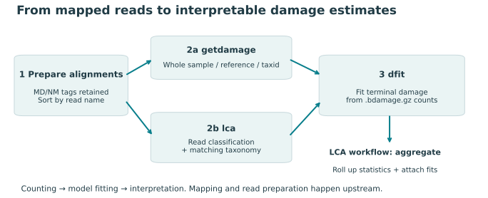
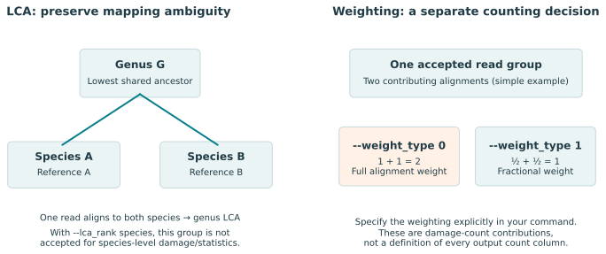
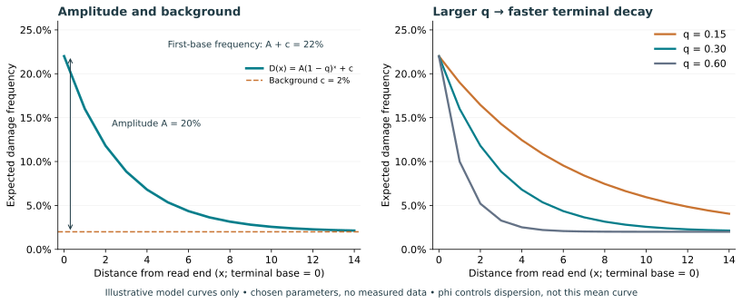

# metaDMG-cpp

[](https://github.com/metaDMG-dev/metaDMG-cpp/actions/workflows/make.yml)

**Estimate ancient-DNA damage from mapped reads, for a whole sample, individual references, or taxonomic groups.**

metaDMG-cpp counts substitutions between reads and their aligned references, then fits the characteristic decrease in terminal damage towards the interior of a read. For metagenomes, it can first assign reads using a lowest common ancestor (LCA) algorithm. It also provides per-read PMD scores and tools for inspecting, filtering, and summarizing results.

You start with **aligned reads**, not FASTQ files. BAM/SAM records must contain `MD:Z` tags, which describe reference mismatches. This lets metaDMG reconstruct the aligned reference bases without a separate FASTA for BAM/SAM analysis; mapping still requires a reference database. CRAM decoding requires the matching reference.

> **Version scope:** this guide describes the `dev2026` source checkout. Packaged releases can have different options and defaults. Check your executable with `metaDMG-cpp --help` and record the version printed to stderr.

**Visual field guide:** [Open the offline HTML guide](doc/field-guide.html) for chapter navigation, searchable parameter notes, and an interactive damage model. Download/open the HTML file locally; GitHub displays its source.

[Install](#1-install) · [Test](#2-test-your-installation) · [Prepare input](#3-prepare-your-own-input) · [Run](#4-choose-and-run-an-analysis) · [Interpret](#5-understand-the-results) · [Troubleshoot](#6-troubleshooting) · [Advanced commands](doc/commands.md) · [Development](doc/development.md)



## 1. Install

### Option A — packaged release with Conda or Mamba

Use an isolated environment containing metaDMG and SAMtools:

```bash
conda create -n metadmg -c conda-forge -c bioconda --strict-channel-priority metadmg samtools
conda activate metadmg
metaDMG-cpp --help
```

You can replace `conda create` with `mamba create`. The [Bioconda package is named `metadmg`](https://anaconda.org/bioconda/metadmg); the executable is `metaDMG-cpp`. This installs a published release, not the current development checkout.

To update that environment:

```bash
conda update -n metadmg -c conda-forge -c bioconda --strict-channel-priority metadmg
```

### Option B — build from source

Use this route to work with development changes or run the repository's full tests. You need Git, Make, a C/C++ compiler, HTSlib, GSL, zlib, and SAMtools for testing/input preparation. Eigen is needed only for the optional regression code, not the normal build.

**Ubuntu/Debian dependencies:**

```bash
sudo apt-get update
sudo apt-get install build-essential git libhts-dev libgsl-dev zlib1g-dev samtools
```

**macOS dependencies (Homebrew):**

```bash
xcode-select --install  # only if the command-line tools are not installed
brew install htslib gsl samtools coreutils
```

Then clone and build, using your installed HTSlib:

```bash
git clone https://github.com/metaDMG-dev/metaDMG-cpp.git
cd metaDMG-cpp
make HTSSRC=systemwide -j2
./metaDMG-cpp --help
```

For Homebrew, supply its installation prefix:

```bash
make HTSSRC=systemwide PREFIX="$(brew --prefix)" -j2
```

These clone commands use the remote's default branch. If you already have the `dev2026` checkout, build there; otherwise select the branch/tag you intend to use before building. Record `git rev-parse HEAD` and any local changes with your results. Build in a path **without spaces**: the Makefile does not consistently quote dependency paths.

<details>
<summary>Other dependency locations, bundled HTSlib, and updating a checkout</summary>

For dependencies installed in a Conda environment or custom prefix:

```bash
make HTSSRC=systemwide PREFIX="$CONDA_PREFIX" -j2
```

The compiler and libraries must target the same architecture. On Apple Silicon, do not mix arm64 Homebrew libraries with an x86_64 Conda environment.

Running plain `make` instead clones and builds HTSlib if it is missing. This needs network access and HTSlib's build dependencies, including compression and curl development libraries. On Ubuntu, also install `libbz2-dev liblzma-dev libcurl4-openssl-dev`.

To update a clean source checkout, first inspect local changes, then pull and rebuild:

```bash
git status --short
git pull --ff-only
make HTSSRC=systemwide -j2
```

Repeat your original `PREFIX` and compiler settings when rebuilding. If you need a clean build, `make clean HTSSRC=systemwide` preserves external HTSlib. **Plain `make clean` deletes the configured HTSlib source directory.**

</details>

## 2. Test your installation

### A small first run

This uses the repository's bundled alignment fixture, so no taxonomy download is needed. Run from the repository root after a source build. For a Conda installation, obtain the repository fixtures with the clone command above and replace `./metaDMG-cpp` below with `metaDMG-cpp`.

```bash
mkdir -p results/quickstart
samtools sort -n test/data/f570b1db7c.dedup.filtered.bam \
  -o results/quickstart/reads.qname.bam

./metaDMG-cpp getdamage results/quickstart/reads.qname.bam \
  --run_mode 0 --min_length 35 --print_length 15 \
  --out_prefix results/quickstart/global

./metaDMG-cpp dfit results/quickstart/global.bdamage.gz \
  --lib ds --seed 12345 --nbootstrap 1 --showfits 2 \
  --out results/quickstart/global

./metaDMG-cpp print results/quickstart/global.bdamage.gz -ctga \
  > results/quickstart/global.damage.tsv

gzip -dc results/quickstart/global.dfit.gz
```

**Success looks like:** each command finishes successfully; `global.bdamage.gz` is nonempty; `global.damage.tsv` contains terminal substitution frequencies; and the compressed `global.dfit.gz` contains a header and a fitted result. The example demonstrates the workflow, not a biological acceptance threshold. Running it again overwrites outputs with the same prefix.

### Full repository checks (source builds)

Build first, then run:

```bash
make test HTSSRC=systemwide
```

The suite runs the taxonomy-sorting regression, DUST and PMD unit checks, and integration checks for damage counting, LCA, fitting, aggregation, and utilities. It needs `samtools`, `c++`, and `md5sum` on `PATH`; on macOS, Homebrew `coreutils` supplies `md5sum`. Results are written under `test/`, with diagnostics in `test/testAll2.sh.log`. A successful full run exits with status 0 and prints `=====RVAL:0=======`.

For a nonstandard dependency prefix, the test script invokes `c++` directly. Make sure its header and library search paths match the build. For example, with Homebrew:

```bash
export CPATH="$(brew --prefix)/include${CPATH:+:$CPATH}"
export LIBRARY_PATH="$(brew --prefix)/lib${LIBRARY_PATH:+:$LIBRARY_PATH}"
make test HTSSRC=systemwide PREFIX="$(brew --prefix)"
```

**Known local validation limit:** the 3 November 2026 Mac check found a global-fit checksum discrepancy in both the baseline and reorganized source. See [the validation record](doc/reorganization-validation.md). A successful smoke test does not imply the full suite passed; investigate failures before accepting a build.

## 3. Prepare your own input

1. **Map and prepare reads upstream.** Adapter trimming, merging/collapsing, duplicate handling, and reference selection are separate decisions. Preserve the alternative alignments needed for LCA; a primary-only BAM cannot recover discarded mapping ambiguity.
2. **Keep alignment tags.** `MD:Z` is needed for mismatch reconstruction. Retain `NM:i` for edit-distance/ANI filtering, and `AS:i` when using `--best_as 1`.
3. **Sort by read name.** In this checkout, both `getdamage` and `lca` check for `SO:queryname` in the BAM/SAM header. Coordinate sorting is insufficient. Sorting also keeps alternative alignments of a read together.

```bash
samtools sort -n sample.bam -o sample.qname.bam
samtools view -H sample.qname.bam
```

If MD/NM tags are missing, regenerate them using the **same reference used for mapping**, then name-sort the result:

```bash
samtools calmd -b sample.bam reference.fa > sample.md.bam
samtools sort -n sample.md.bam -o sample.qname.bam
```

For LCA you also need matching `names.dmp[.gz]`, `nodes.dmp[.gz]`, and an accession-to-taxid table. The reference names in the BAM header must resolve through that mapping. Use a taxonomy snapshot consistent with your mapping database; the small files in `test/data/` are only fixtures. [Taxonomy setup and advanced controls](doc/commands.md#taxonomic-resources).

## 4. Choose and run an analysis

| Your question | Command | What is grouped together? |
| --- | --- | --- |
| Is there a terminal damage pattern across this alignment file? | `getdamage --run_mode 0` | All accepted alignments |
| How does damage vary among references/contigs? | `getdamage --run_mode 1` | Each BAM reference separately |
| How does damage vary among mapped taxids, without LCA? | `getdamage --run_mode 2 --acc2tax …` | References mapped to a taxid |
| What damage is associated with taxonomically classified reads? | `lca` → `dfit` → `aggregate` | LCA classification, followed by taxonomic summaries |
| What is the PMD score of an individual read? | `pmd` | Read-level likelihood-ratio score |

### A. Whole sample or individual references

```bash
mkdir -p results/sample
./metaDMG-cpp getdamage sample.qname.bam \
  --run_mode 0 --min_length 35 --print_length 15 \
  --out_prefix results/sample/global

./metaDMG-cpp dfit results/sample/global.bdamage.gz \
  --lib ds --seed 12345 --nbootstrap 1 --showfits 2 \
  --out results/sample/global
```

For per-reference results, use `--run_mode 1`, a distinct output prefix, and add `--bam sample.qname.bam` to `dfit` to label the internal reference IDs. For direct taxid grouping, use `--run_mode 2 --acc2tax taxonomy/acc2taxid.map.gz`; this does **not** perform LCA assignment. Multi-mapped reads can contribute more than once in these counting modes.

### B. Metagenome with LCA

Run from the repository root so `rank2level.txt` is available. From another directory, set `METADAMAGE_RANK_LEVELS` to its absolute path.

The example below uses placeholder input paths: replace them with your BAM and matching taxonomy. It explicitly selects fractional weighting, a 35-base minimum read length, and an ANI range of 0.95–1.0. These are example choices to assess for your data, not universal filtering thresholds.

```bash
mkdir -p results/sample
./metaDMG-cpp lca --bam sample.qname.bam \
  --names taxonomy/names.dmp.gz --nodes taxonomy/nodes.dmp.gz \
  --acc2tax taxonomy/acc2taxid.map.gz \
  --min_length 35 --min_mapq 0 --sim_score_low 0.95 --sim_score_high 1.0 \
  --how_many 15 --weight_type 1 --lca_rank species \
  --used_reads 0 --famout 0 --out_prefix results/sample/lca

./metaDMG-cpp dfit results/sample/lca.bdamage.gz \
  --names taxonomy/names.dmp.gz --nodes taxonomy/nodes.dmp.gz \
  --lib ds --seed 12345 --nbootstrap 1 --showfits 2 \
  --out results/sample/fit

./metaDMG-cpp aggregate results/sample/lca.bdamage.gz \
  --names taxonomy/names.dmp.gz --nodes taxonomy/nodes.dmp.gz \
  --lcastat results/sample/lca.stat.gz --dfit results/sample/fit.dfit.gz \
  --rlens results/sample/lca.rlens.gz --out results/sample/summary

gzip -dc results/sample/summary.stat.gz > results/sample/summary.tsv
```

`lca` groups alternative alignments by read name. `--lca_rank species` restricts the groups used for damage/statistics to that rank or more specific levels; it does not turn ambiguous genus-level assignments into species identifications. `dfit --nodes` allows fits at higher taxonomic nodes. `aggregate` rolls up statistics and attaches the supplied fits; it does not refit damage parameters.

`--weight_type 1` uses fractional alignment contributions to damage counts. The current source initializes this option to **0**, so specify **1** explicitly when you want fractional weighting. Do not interpret every reported count as a count of unique molecules. `--used_reads 0 --famout 0` avoids writing the two optional BAM outputs; set either to 1 when needed.



For a fixture-based LCA trial, substitute `results/quickstart/reads.qname.bam` and the three files in `test/data/`, use `--fix_ncbi 0` as in the integration tests, and use a separate output prefix. Taxonomy name normalization must match your database; see the advanced reference.

### C. Per-read PMD scores

```bash
./metaDMG-cpp pmd sample.qname.bam > results/sample/pmd.tsv
```

Output is `read_name<TAB>PMD: score`. This is a read-level score, distinct from a fitted taxon-level damage amplitude. The default `-a 1` excludes paired-end records and keeps single-end/collapsed reads; use `-a 0` if including paired-end records is intentional. PMD currently runs single-threaded. See [PMD options](doc/commands.md#pmd-read-level-scores).

## 5. Understand the results



*Illustration only: these curves are generated from chosen parameters, not observed data or a validation result.*

The fitted mean is `D(x) = A × (1 − q)^x + c`, with terminal distance `x = 0` at the first base.

| Quantity | Meaning | Interpretation |
| --- | --- | --- |
| `A` | Terminal amplitude above background | The predicted first-base frequency is **A + c**, not A alone |
| `q` | Decay per position | Larger q gives a faster decline towards the interior |
| `c` | Background mismatch component | Can reflect several sources of mismatch; not solely sequencing error |
| `phi` | Beta-binomial concentration | Larger values approach binomial variation; not a confidence interval |
| `A_b`, `q_b`, `c_b`, `phi_b` | Bootstrap summaries in this C++ checkout | These are not Bayesian MAP estimates |
| `*_CI_l`, `*_CI_h` | Bootstrap confidence bounds | Interpret with the selected resampling/CI method; not Bayesian credible intervals |
| `sigmaD_old`, `sigmaD_new` | Legacy and updated uncertainty estimates | Keep their matching `Zfit` columns together |
| `Zfit_old`, `Zfit_new` | Corresponding damage scores | Not probabilities that a taxon is ancient or correctly identified |

Use `--lib ds` for the double-stranded model (5′ C→T and 3′ G→A) and `--lib ss` for the single-stranded model (C→T at both ends). Match this to library preparation. In this checkout, `--nbootstrap 1` runs the beta-binomial fit without bootstrap summaries; values **greater than 1** enable resampling and additional summaries. A value of 0 is rejected. Two replicates can exercise the code but do not establish a useful confidence interval.

Inspect terminal counts, curve shape, fit behaviour, read support, and mapping/taxonomic evidence together. Sparse groups may give unstable or boundary estimates. Damage alone does not establish taxonomic identity, sample age, or authenticity; library treatment can also alter the pattern.

### Which file should I open?

| File | Contents / next step |
| --- | --- |
| `*.bdamage.gz` | Binary substitution counts; use `metaDMG-cpp print`, not a text viewer |
| `*.dfit.gz` | Compressed tab-separated fit parameters; read with `gzip -dc` |
| `*.lca.gz` | Per-read LCA assignments and associated fields |
| `*.stat.gz` from counting/LCA | Group summary statistics |
| `summary.stat.gz` from `aggregate --out summary` | Taxonomic roll-up, plus fit columns if `--dfit` was supplied |
| `*.rlens.gz` | Read-length distributions; optionally aggregated with `--rlens` |
| `*.usedreads.bam`, `*.famoutreads.bam` | Optional LCA alignment outputs |

Keep prefixes distinct for counting, fitting, and aggregation to avoid overwriting statistics. Read columns by **header name**, not fixed position. In per-reference mode, numeric IDs are BAM reference offsets; in LCA/taxid mode they are taxids. Ancestor and descendant summaries overlap, so summing all taxonomy rows double-counts evidence.

To export frequencies or counts:

```bash
./metaDMG-cpp print results/sample/lca.bdamage.gz -ctga > results/sample/damage.tsv
./metaDMG-cpp print results/sample/lca.bdamage.gz -countout > results/sample/counts.tsv
```

## 6. Troubleshooting

| Symptom | Check / action |
| --- | --- |
| `metaDMG-cpp: command not found` | Activate the Conda environment, or use `./metaDMG-cpp` from the build directory |
| Missing HTSlib/GSL headers or libraries | Use `HTSSRC=systemwide`, the correct `PREFIX`, and matching compiler/library architectures |
| Input is not sorted | Run `samtools sort -n`; check `@HD` contains `SO:queryname` |
| Missing MD/NM/AS tags | Preserve aligner tags; regenerate MD/NM with the original mapping reference; AS is needed for `--best_as 1` |
| Missing accession/taxid or rank mapping | Check BAM reference names against the mapping and taxonomy snapshot; set `METADAMAGE_RANK_LEVELS` when outside the repository |
| Few or no results | Check read length, ANI/edit-distance, MAPQ, rank, and flag filters; inspect the log before changing thresholds |
| Multi-mappers disappear | Positive MAPQ thresholds may remove ambiguous alignments; check the aligner's MAPQ semantics |
| Unexpected output filename | Fits use `.dfit.gz`; aggregate uses `.stat.gz` in this checkout |
| Test checksum differs | Read the log and [known local discrepancy](doc/reorganization-validation.md); do not change expected hashes merely to pass |

For reproducible runs, retain the software revision, exact commands, library type, random seed, reference/taxonomy versions, input provenance, and logs. A fixed seed does not guarantee identical numerical results across platforms or thread settings.

More detail: [advanced command reference](doc/commands.md), [binary format reference](doc/formats.pdf), and [source/development guide](doc/development.md). Report reproducible problems through [GitHub issues](https://github.com/metaDMG-dev/metaDMG-cpp/issues), including the command, version, and relevant diagnostics.

The [offline field guide](doc/field-guide.html) is generated from this README and local presentation assets. To regenerate it, install Pandoc and run `python3 doc/build_field_guide.py`.
